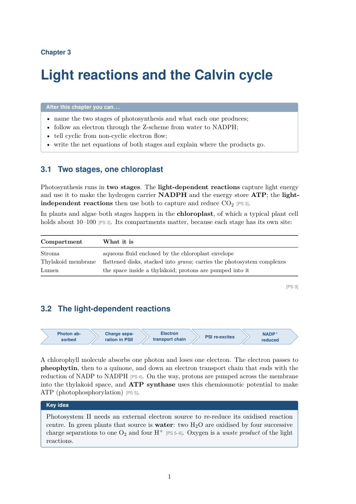
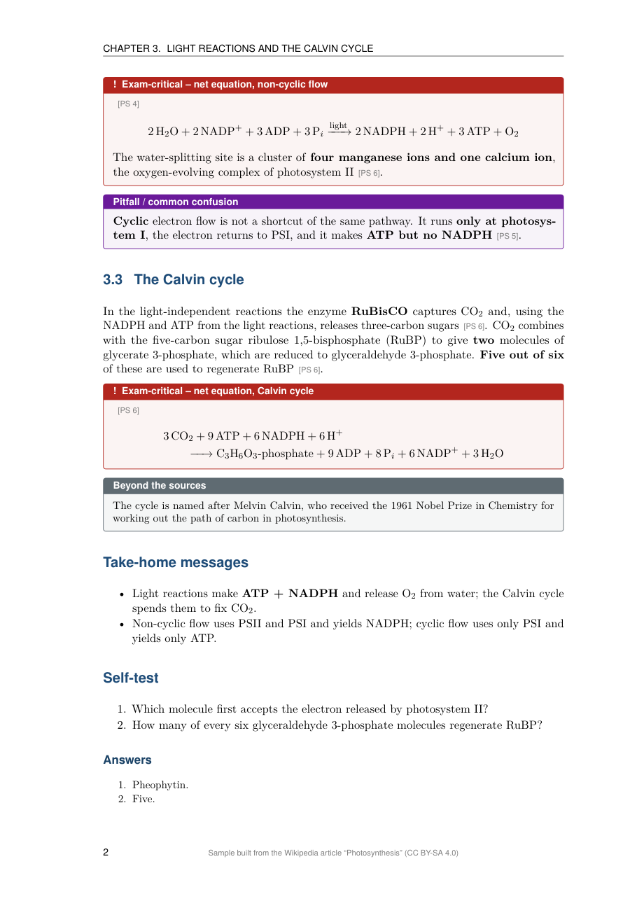

# study-book — a Claude Code skill

Turns the PDFs of a university course (lecture slides, textbook chapters, papers, syllabus, past
exams, scanned pages, notebook printouts) into a **complete, structured study book written in
LaTeX and compiled to PDF**. Every factual paragraph is tagged with the PDF page it comes from,
e.g. `[PS 4]`, so you can always go back to the original.

<p align="center">
  
  
</p>
<p align="center"><sub>Two pages of a sample chapter. Source: the Wikipedia article
<a href="https://en.wikipedia.org/wiki/Photosynthesis">"Photosynthesis"</a> (tag <code>PS</code>; the numbers are its PDF pages).
These images are licensed <a href="https://creativecommons.org/licenses/by-sa/4.0/">CC BY-SA 4.0</a>.</sub></p>

## Contents

1. [Description](#description)
2. [When to use it (triggers)](#when-to-use-it-triggers)
3. [Requirements](#requirements)
4. [Installation](#installation)
5. [Usage](#usage)
6. [How it works](#how-it-works)
7. [Output](#output)
8. [Limitations](#limitations)
9. [Troubleshooting](#troubleshooting)
10. [Giving feedback](#giving-feedback)
11. [Repository layout](#repository-layout)

## Description

The finished book contains:

- a title page and a "how to use this book" chapter;
- an **overview map** showing how the chapters build on each other (solid arrows = stated in the
  sources, dashed arrows = inferred);
- one chapter per topic, each with learning objectives, explanations, comparison tables and
  figures cropped from the slides;
- boxes for *exam-critical* facts, *common pitfalls*, *key ideas* and *beyond-the-sources* context;
- every question the lecturer highlighted in the material (e.g. printed in red), answered as a
  model exam answer;
- take-home messages and a self-test with answers at the end of each chapter;
- worked-code sections, if you provide notebooks (`.ipynb`, `.py`, `.R`);
- appendices: topics announced but not covered, a cheat sheet, an index of all lecturer questions,
  and a corrections list.

Each of these features can be switched off during planning.

## When to use it (triggers)

Use it when you want a study guide, study book, exam-prep book, revision book or course script made
from course PDFs. Type any of these in Claude Code, inside the book folder (see [Usage](#usage)):

- `/study-book`
- "Make a study book from the PDFs in the parent folder."
- "Create an exam study guide from these lecture slides."
- "Build a revision book for my exam on <subject> from the slides in `..`."

If the PDFs are not in the parent folder, say where they are: "…from the PDFs in `D:\Courses\Stats`".

## Requirements

| Requirement | Details |
|---|---|
| **Claude Code** | CLI, desktop app or IDE extension. The skill needs local files, shell commands and parallel subagents, so it does **not** work in the claude.ai chat. |
| **Claude plan** | A full book is a long, token-heavy run (many subagents). Max is recommended. On Pro you may hit usage limits partway through; the run resumes from `PLAN.md`. |
| **LaTeX distribution** | **Windows:** [MiKTeX](https://miktex.org) (the skill switches on automatic package installs). **macOS:** [MacTeX](https://tug.org/mactex/). **Linux:** `texlive-full`, or at least the packages for tcolorbox, siunitx, mhchem, pgfplots, cleveref, listings and babel. |
| **latexmk** | Included in MiKTeX and TeX Live. On Windows it needs Perl ([Strawberry Perl](https://strawberryperl.com)); MiKTeX prompts for it if missing. |
| **Python 3.9+** | The skill installs its only dependency, [PyMuPDF](https://pymupdf.readthedocs.io), into a venv in the book folder if needed. |
| **Optional** | A `council-review` skill, to review the backbone and chapter plan before you approve them. The planning phase asks whether you have it and want to use it; it uses many tokens, so the default is "no". |

Check your setup:

```bash
pdflatex --version
latexmk --version
python --version          # or: py --version  (Windows)
```

## Installation

Clone the repository into your personal skills folder:

```bash
# macOS / Linux / Git Bash on Windows
git clone https://github.com/jose-jeronimo/study-book.git ~/.claude/skills/study-book
```

```powershell
# Windows PowerShell
git clone https://github.com/jose-jeronimo/study-book.git "$env:USERPROFILE\.claude\skills\study-book"
```

Restart Claude Code. The skill now appears among the available skills (`/study-book`).

To update later:

```bash
git -C ~/.claude/skills/study-book pull
```

## Usage

### 1. Prepare the course folder

The skill expects to be started **inside an empty subfolder next to the PDFs**:

```
MyCourse/
├── Lecture01_Intro.pdf
├── Lecture02_Methods.pdf
├── Syllabus.pdf               ← optional: defines the scope
├── Exam_2024.pdf              ← optional: past exams weight topics and add questions
├── analysis.ipynb             ← optional: notebooks become worked-code sections
└── study_book/                ← create this and open Claude Code here
```

Tips:

- Use clear file names (`Exam_2024.pdf`, `Syllabus.pdf`): the inventory guesses each file's role
  from its name. You confirm or correct the roles during planning anyway.
- Put only course material in the folder. Every PDF there is treated as a source.
- Scanned PDFs work, but they take longer and their numbers get a second, independent read.

### 2. Start the run

```bash
cd MyCourse
mkdir study_book
cd study_book
claude
```

Then trigger the skill (see [triggers](#when-to-use-it-triggers)). Plan for a long session, often
several hours for a full course. You can stop at any time and continue later.

### 3. Answer the planning questions

Before writing anything, the skill scans the PDFs and asks all of its questions up front, in a few
rounds of multiple-choice questions with recommended defaults:

| Round | Asks about |
|---|---|
| Course and exam | course name and lecturers, exam date and format, lecturer hints, output language |
| Sources | role and short tag of each PDF, which highlighted questions are real exam hints, how to handle notebooks and scanned pages |
| The book | features to switch off, depth (compact 4–8 / standard 8–15 / exhaustive 15–25 pages per chapter), audience level, book title and PDF name |
| Run | reuse an existing outline, whether you have `council-review` installed and want it to review the chapter plan, whether to write a [feedback report](#giving-feedback) at the end |

### 4. Approve at the two checkpoints

1. **Planning summary**: you confirm the settings before any content is generated.
2. **Backbone and chapter plan**: you review the course outline, the glossary and the chapter
   table (chapters, assigned source pages, dependencies, figures) and ask for changes if needed.
   If you chose the council review, its suggestions are shown here for you to accept or reject.

After the second approval the skill runs to the finished PDF on its own, unless a step fails
beyond its retry limit; then it stops and tells you what failed and what you can do.

### 5. Resume an interrupted run

Open Claude Code in the same book folder and say "continue the study book". The skill reads
`PLAN.md`, re-checks the last finished step and every finished chapter against the files on disk,
and continues from the first step that does not pass.

### 6. Edit and rebuild

The `.tex` files are yours to edit. Rebuild with `latexmk` in the book folder, or with VS Code +
LaTeX Workshop (a `.vscode/settings.json` is included).

## How it works

The skill runs in 13 steps (0–12), recording every decision, status and problem in `PLAN.md`:

| # | Step | What happens |
|---|---|---|
| 0 | Preflight | checks LaTeX and Python, creates a venv if needed, runs a test compile |
| 1 | Inventory | scans all PDFs: pages, scanned vs. text pages, language, highlighted questions |
| 2 | Planning Q&A | all questions up front. **You confirm the plan.** |
| 3 | Stage 1 | subagents take notes on each source; these are merged into a course outline (the "backbone") and a shared glossary |
| 4 | Chapter plan | chapters, source pages per chapter, dependencies, figures; optional council review of the structure. **You review it.** |
| 5 | Scaffold | LaTeX skeleton, overview map, figure crops; the empty book must compile |
| 6 | Pilot chapter | one chapter is written and checked first |
| 7 | Chapters | written in parallel by subagents; each must compile on its own and pass a check that its numbers and key terms appear on the cited source pages |
| 8 | Second read | values from scanned pages are read again independently; disagreements are marked in the book |
| 9 | Appendices | missing topics, cheat sheet, lecturer-question index, corrections |
| 10 | Full build | `latexmk`, with errors and warnings fixed |
| 11 | QA and report | source-page coverage, visual page check, gap test against past exams (if provided), final report with a list of high-stakes claims for you to check |
| 12 | Feedback report | only if chosen in planning: a report on how the run went, for the skill's author |

## Output

```
study_book/
├── build/<Title>.pdf       ← the finished book
├── main.tex, preamble.tex, chapters/, figures/   ← editable LaTeX sources
├── PLAN.md                 ← every decision, chapter status and log
├── backbone.md, glossary.md                      ← course outline and terminology
├── coverage.md             ← source pages never cited
├── study-book-feedback_<date>.md                 ← only if you chose the feedback report
└── source/, notes/, ledger/                      ← intermediate files (safe to delete afterwards)
```

The final report lists page and chapter counts, source coverage, any chapters that failed their
checks, the number of uncertain values, and a short **spot-check list** of high-stakes claims with
their source pages.

## Limitations

> **What the checks do and do not guarantee.** A source tag shows *where* a statement comes from,
> not that it is correct. The checks confirm that numbers and key terms appear on the cited page;
> they do not prove that the surrounding sentence is right. The book is a study aid to read
> alongside the original material. Check exam-critical values on the cited pages.

- Content outside the sources is allowed only in clearly marked "beyond the sources" boxes.
- Values read from scanned pages are the weakest point; disagreements between the two reads are
  marked with an "unsure" marker and listed in the corrections appendix.
- The past-exam gap test finds topics the book does not answer; it does not certify the book.

## Troubleshooting

| Problem | What to do |
|---|---|
| `latexmk` fails on Windows | Install [Strawberry Perl](https://strawberryperl.com) and restart the terminal. |
| Usage limit reached mid-run | Wait, then reopen Claude Code in the book folder and say "continue the study book". |
| A chapter is marked FAILED | It failed its check after the retry limit. The report and `PLAN.md` → Log say why; ask Claude to retry that chapter. |
| PDFs not found | The default source folder is `..`. Say where the PDFs are when triggering, or move the book folder next to them. |

## Giving feedback

The skill is still being improved, and reports from real courses help most. During planning you
are asked whether to write a **feedback report**. If you say yes, then at the end of the run (or
when it stops on a failure) the skill writes `study-book-feedback_<date>.md` in the book folder
with:

- your setup and the skill version;
- the size and kind of input (number of PDFs and pages, scanned pages, languages);
- your planning choices and the structural changes you asked for;
- results: chapters passed or failed, fix rounds, coverage, build iterations;
- every problem met during the run (reading the sources, structure, build, scripts) and what was
  done about it;
- your own comments, if you want to add any.

The report contains **no course content** (no slide text, no names, no exam questions), and
nothing is sent automatically. Read it, edit it if you like, and send it to the author, e.g. as a
GitHub issue on this repository.

## Repository layout

```
SKILL.md                  entry point read by Claude (steps, approval points, rules)
references/               detailed instructions loaded per step
templates/                LaTeX skeleton, PLAN.md, build configs
scripts/                  inventory, extraction, figure cropping, chapter check, coverage, previews
docs/                     sample page images for this README
```

The scripts can also be run by hand from the book folder with the venv's Python:

| Script | Purpose |
|---|---|
| `inventory.py <src> [out]` | sources table, text vs. image pages, highlighted question candidates |
| `extract_sources.py <src> tags.json [dpi]` | per-page text (and images for scanned pages) under `source/<TAG>/` |
| `extract_figures.py <src> [names]` | figure crops from `figures/manifest.json` |
| `check_chapter.py chapters/NN-key.tex [--no-compile] [--appendix]` | chapter check: compile, labels, refs, source-page ledger |
| `coverage.py [chapters] [source]` | uncited source pages → `coverage.md` |
| `render_preview.py <pdf> <out> <pages> [dpi]` | PNG previews of pages for visual checks |

## License

[MIT](LICENSE). The sample page images in `docs/` are derived from Wikipedia text and are
licensed [CC BY-SA 4.0](https://creativecommons.org/licenses/by-sa/4.0/).
